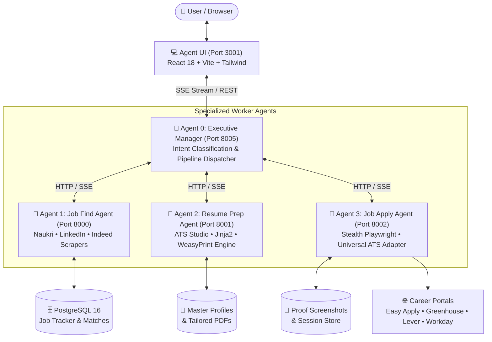

# Sensa AI — Autonomous Hierarchical Multi-Agent Career Platform

[](https://www.python.org/)
[](https://fastapi.tiangolo.com/)
[](https://react.dev/)
[](https://www.typescriptlang.org/)
[](https://playwright.dev/)
[](https://tailwindcss.com/)
[](https://www.docker.com/)
[](LICENSE)

An enterprise-grade, distributed multi-agent system that automates the entire end-to-end job application lifecycle: live multi-platform job discovery, semantic resume scoring, pixel-perfect ATS resume tailoring, and autonomous browser portal submissions.

---

## 🏗️ System Architecture



---

## ✨ Core Features & Microservices

### 1. 🧠 Agent 0: Executive Manager Agent (`manager-agent`, Port `8005`)
- **LLM Intent Routing:** Classifies incoming user queries using dual LLM engines (NVIDIA NIM / Gemini / Ollama) into single-target tasks or multi-step autonomous workflows.
- **Hierarchical Pipeline Coordination:** Sequentially chains `Find ➔ Tailor ➔ Review ➔ Apply` with real-time Server-Sent Events (SSE) telemetry.
- **Fair Multi-Platform Queuing:** Balances applications evenly across portals so no single platform dominates the batch.

### 2. 🔎 Agent 1: Job Find & Tracking Agent (`job-find-agent`, Port `8000`)
- **Live Multi-Portal Search:** Scrapes and normalizes openings from Naukri, LinkedIn, and Indeed in real-time.
- **Semantic Scoring:** Evaluates candidate resumes against job descriptions, returning match percentages (0–100%), matching skills, and gap keywords.
- **Persistent Tracker:** Backed by PostgreSQL 16 to track statuses across `DISCOVERED`, `SAVED`, `APPLIED`, and `INTERVIEW`.

### 3. 📄 Agent 2: ATS Resume Prep Agent (`resume-prep-agent`, Port `8001`)
- **ATS Studio:** Live interactive dual-pane markdown editor and A4 paper canvas.
- **4 Modular ATS Layouts:**
  - *Tech Sidebar:* Two-column layout optimized for engineers and architects.
  - *Modern Clean:* Corporate styling with clean metric callouts.
  - *Sleek Minimalist:* High-density executive format.
  - *Grid Matrix:* Compact structured layout.
- **Zero Bottom Whitespace Pagination:** Dynamic budget calibration ensuring multi-page documents fill exactly 1, 2, or 3 pages without dangling lines.
- **Vector PDF Compilation:** Generates high-fidelity ATS-compliant PDFs using Jinja2 and WeasyPrint.

### 4. 🚀 Agent 3: Stealth Job Apply Agent (`job-apply-agent`, Port `8002`)
- **Dual Flow Automation:**
  - **In-App Easy Apply:** Completes multi-step LinkedIn Easy Apply and Naukri 1-Click modals, answering screening questions and uploading tailored PDFs.
  - **Universal External ATS Engine:** Detects and auto-populates forms across Greenhouse, Lever, Workday, SmartRecruiters, Ashby, and company career sites.
- **Human-in-the-Loop Review Gate:** Optional interactive checkpoint letting candidates review auto-filled forms before final submission.
- **Cryptographic Audit Proof:** Captures verified submission receipt screenshots and logs timestamped entries to `apply_audit.db`.

### 5. 💻 Agent UI (`agent-ui`, Port `3001`)
- Built with React 18, Vite, TypeScript, and Tailwind CSS.
- Real-time token streaming, live progress telemetry docks, candidate master profile editor, platform session status toggles, and interactive job tracker modals.

---

## 🔌 Microservices Port & API Directory

| Service | Port | Primary Tech Stack | Key Endpoints |
| :--- | :---: | :--- | :--- |
| **Agent UI** | `3001` | React 18, Vite, TypeScript, Tailwind | Web Interface (`http://localhost:3001`) |
| **Manager Agent** | `8005` | FastAPI, Pydantic, HTTPX, SSE | `POST /api/chat/stream`, `POST /api/v1/dispatch` |
| **Job Find Agent** | `8000` | FastAPI, SQLAlchemy, PostgreSQL, Scrapy | `POST /api/jobs/search`, `POST /api/jobs/score` |
| **Resume Prep Agent** | `8001` | FastAPI, Jinja2, WeasyPrint, Pydantic | `POST /api/resume/tailor`, `POST /api/resume/recompile` |
| **Job Apply Agent** | `8002` | FastAPI, Playwright, SQLite, Stealth | `POST /api/apply/stream`, `GET /api/apply/auth/{plat}/status` |
| **PostgreSQL DB** | `5432` | PostgreSQL 16 Alpine | Persistent Application & Job Records |

---

## 🚀 Quickstart Guide

### Option A: One-Click Docker Compose (Recommended)

Ensure Docker and Docker Compose are installed:

```bash
# 1. Clone the repository
git clone https://github.com/SandyTechWise/sensa-ai.git
cd sensa-ai

# 2. Configure environment keys
cp manager-agent/.env.example .env
# Edit .env with your NVIDIA_API_KEY, GEMINI_API_KEY, or local Ollama URL

# 3. Boot all microservices
docker-compose up --build -d

# 4. Open in browser
# Navigate to http://localhost:3001
```

---

### Option B: Local Development Setup

#### 1. Prerequisites
- **Python 3.12+**
- **Node.js 18+ & npm**
- **PostgreSQL 16** (or SQLite fallback)

#### 2. Install Dependencies

```bash
# Frontend
cd agent-ui && npm install && cd ..

# Backend Microservices
python3 -m venv venv
source venv/bin/activate

pip install -r manager-agent/requirements.txt
pip install -r job-find-agent/requirements.txt
pip install -r resume-prep-agent/requirements.txt
pip install -r job-apply-agent/requirements.txt

# Install Playwright browser binaries
playwright install chromium
```

#### 3. Start All Services
```bash
# Make startup scripts executable
chmod +x start.sh stop.sh

# Launch all 5 microservices in the background
./start.sh
```

To stop all services:
```bash
./stop.sh
```

---

## 🔒 Security & Privacy

- **No Stored Passwords:** Platform authentication uses encrypted browser session tokens (`cookies`) stored exclusively in local, git-ignored directories.
- **Private Data Isolation:** Candidate resumes, local SQLite audit logs, and submission screenshots are strictly excluded from version control via `.gitignore`.
- **Bot Detection Evasions:** Uses `playwright-stealth` with randomized human keystroke intervals (80–220ms), mouse movements, and natural viewport scrolling.

---

## 👤 Author

**S. Senkathirselvan**  
- **Role:** Python Backend Developer & Distributed Multi-Agent Architect  
- **GitHub:** [@SandyTechWise](https://github.com/SandyTechWise)  
- **LinkedIn:** [linkedin.com/in/senkathirselvan-python-developer](https://linkedin.com/in/senkathirselvan-python-developer)  
- **Email:** senkathircomp@gmail.com

---

## 📄 License

This project is licensed under the MIT License — see the [LICENSE](LICENSE) file for details.
